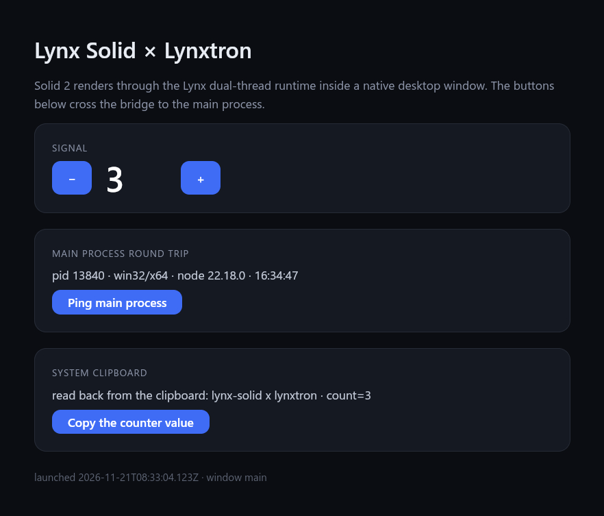

import { Badge } from '@theme'

# Desktop apps with Lynxtron

<Badge text="experimental" type="warning" />

[Lynxtron](https://github.com/lynx-family/lynxtron) is Lynx's desktop shell: an Electron-style main process plus a `LynxWindow` that loads `*.lynx.bundle` files. The UI half is an ordinary Lynx Solid app — same components, same signals, same dual-thread runtime — so the only new work is the shell around it.

There is no live preview on this page: a desktop shell cannot run in a browser. The screenshot below is the app in `apps/lynxtron`, running on Windows.



## Two builds, one app

A desktop app is two rsbuild builds. The UI build is the one you already know; the main-process build is Node code that creates the window.

| Half | Config | Output | Entry |
| --- | --- | --- | --- |
| UI | `rsbuild.config.ts` | `output/bundle/lynx/main.lynx.bundle` | `src/index.tsx` |
| Main process | `rsbuild.desktop.config.ts` | `dist/desktop/main.js` | `src/main/desktop/main.ts` |

```ts title="rsbuild.config.ts"
import { pluginSolidLynx } from '@lynx-solid/plugin'
import { defineConfig } from '@rsbuild/core'

export default defineConfig({
  environments: {
    lynx: {
      // Lynxtron loads bundles from this directory — the shell's convention.
      output: { distPath: { root: 'output/bundle/lynx' } },
    },
    web: {},
  },
  source: { entry: { main: './src/index.tsx' } },
  plugins: [pluginSolidLynx()],
})
```

The main process is built with `pluginLynxtron()`, not `pluginSolidLynx()`. It requires `output.target: 'node'`, marks every dependency declared in `package.json` as external (they ship next to the app), and — in dev — launches `lynxtron dist/desktop` and restarts it on rebuild.

```ts title="rsbuild.desktop.config.ts"
import { pluginLynxtron } from '@lynx-js/lynxtron-dev-plugins/rsbuild'
import { defineConfig } from '@rsbuild/core'

export default defineConfig(({ command }) => ({
  environments: {
    desktop: {
      source: { entry: { main: './src/main/desktop/main.ts' } },
      output: {
        target: 'node',
        distPath: { root: './dist/desktop' },
        copy: [
          { from: './package.json', to: 'package.json' },
          // Dev loads the UI from the dev server; only a production build
          // needs the bundle next to main.js.
          ...(command === 'build' ? [{ from: './output/bundle/lynx/', to: '.' }] : []),
        ],
      },
      dev: { writeToDisk: true },
      plugins: [pluginLynxtron({ env: { LYNXTRON_DEV: '1' } })],
    },
  },
}))
```

## Talking to the main process

Two directions, two APIs — both are ambient globals in the UI bundle, not imports:

| Direction | UI side | Main side |
| --- | --- | --- |
| UI → main | `NativeModules.bridge.call(method, params, cb)` | `lynxBridge.handle(method, (event, params) => …)` |
| main → UI | `lynx.getJSModule('GlobalEventEmitter').addListener(name, fn)` | `win.sendGlobalEvent(name, payload)` |

```ts
// UI
NativeModules.bridge.call('demo:ping', { sentAt: Date.now() }, () => {})

// main
lynxBridge.handle('demo:ping', () => {
  win.sendGlobalEvent('demo:pong', { pid: process.pid })
  return ''
})

// UI
lynx.getJSModule('GlobalEventEmitter').addListener('demo:pong', (payload) => {
  // payload is what sendGlobalEvent received
})
```

Payloads cross the process boundary as JSON, so keep them serializable.

:::warning Lynxtron 0.0.31
`NativeModules.bridge` exposes `call` and `on` only. The `send` you may see in newer documentation does not exist in this version; replies go through `sendGlobalEvent`.
:::

## Running the app

```bash
cd apps/lynxtron
nub install
nub run dev      # UI dev server + main process, restarts the window on rebuild
nub run start    # production shape: build both halves, run lynxtron dist/desktop
```

The first `lynxtron` run downloads the desktop runtime into the npm cache (about 180 MB on Windows); later runs reuse it. `nub run dev` also enables the Lynx DevTool, so `npx agent-lynx list-clients` can find the window and take snapshots or screenshots.

:::tip Dev launcher and package managers
The dev build starts the app with `lynxtron` from PATH and hands it the build's environment. If your package manager injects `NODE_OPTIONS` (nub does, as a `--require` preload), the runtime applies it to its main process and `main.js` never runs — the window never appears. `apps/lynxtron/rsbuild.desktop.config.ts` clears `NODE_OPTIONS` and puts the build's own Node first for that child.
:::

## What 0.0.x asks of you

- **The API moves between releases.** The runtime version equals the `@lynx-js/lynxtron` package version; pin it and re-read the changelog before bumping.
- **A preload's isolated context has no `LynxWindow` or `clipboard`.** Window control belongs in the main process; the demo does not use a preload at all.
- **`ready-to-show` is documented but not declared** in 0.0.31's type definitions, and has moved before. Keep a timeout fallback that shows the window anyway — a hidden window looks like a crash.
- **Frameless windows are not draggable by default.** Add `-x-app-region: drag` to the title bar (Electron's `-webkit-app-region`), and keep buttons outside the drag region.
- **Linux supports headless rendering only** (`windowless: true`); windowed mode is Windows and macOS.
- **`lynxtron` defaults to the DevTool runtime.** The packager (`lynxtron-builder`) defaults to release — do not ship a devtool runtime.
- **These versions look older than the rest of the repo on purpose.** They mirror the last published `@lynx-solid/*` release and the build chain that release was published against; a newer `@lynx-js/rsbuild-plugin` in the manifest would not change what the published plugin loads.
