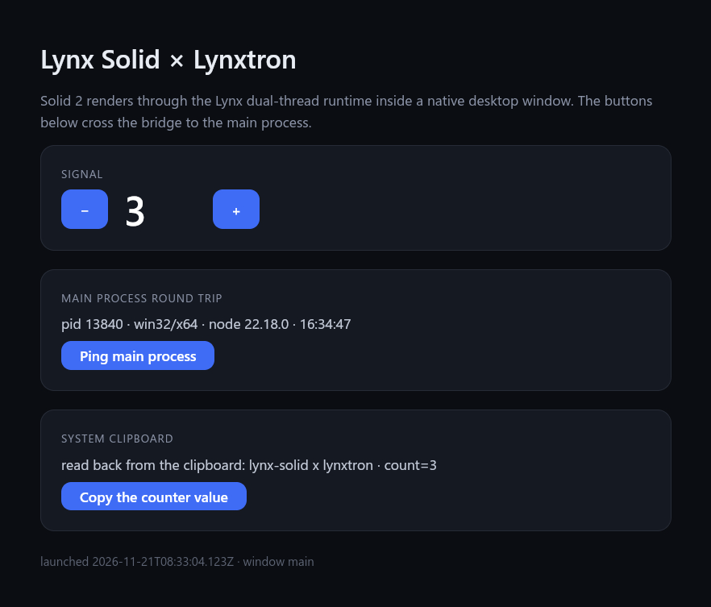

import { Badge } from '@theme'

# 桌面应用：Lynxtron

<Badge text="实验性" type="warning" />

[Lynxtron](https://github.com/lynx-family/lynxtron) 是 Lynx 的桌面壳：一个 Electron 形态的主进程，加上一个加载 `*.lynx.bundle` 的 `LynxWindow`。UI 那一半仍然是普通的 Lynx Solid 应用——同样的组件、同样的信号、同样的双线程运行时——真正要新写的只有外面这层壳。

这一页没有在线预览：桌面壳在浏览器里跑不起来。下面的截图是 `apps/lynxtron` 在 Windows 上的实际窗口。



## 一个应用，两次构建

桌面应用是两份 rsbuild 构建。UI 那份就是你熟悉的那份；主进程那份是创建窗口的 Node 代码。

| 部分 | 配置 | 产物 | 入口 |
| --- | --- | --- | --- |
| UI | `rsbuild.config.ts` | `output/bundle/lynx/main.lynx.bundle` | `src/index.tsx` |
| 主进程 | `rsbuild.desktop.config.ts` | `dist/desktop/main.js` | `src/main/desktop/main.ts` |

```ts title="rsbuild.config.ts"
import { pluginSolidLynx } from '@lynx-solid/plugin'
import { defineConfig } from '@rsbuild/core'

export default defineConfig({
  environments: {
    lynx: {
      // Lynxtron 从这个目录取 bundle，这是壳自己的约定。
      output: { distPath: { root: 'output/bundle/lynx' } },
    },
    web: {},
  },
  source: { entry: { main: './src/index.tsx' } },
  plugins: [pluginSolidLynx()],
})
```

主进程用的是 `pluginLynxtron()`，不是 `pluginSolidLynx()`。它要求 `output.target: 'node'`，把 `package.json` 里声明的每个依赖标成 external（它们随应用一起分发），并且在 dev 模式下拉起 `lynxtron dist/desktop`、每次重建后重启窗口。

```ts title="rsbuild.desktop.config.ts"
import { pluginLynxtron } from '@lynx-js/lynxtron-dev-plugins/rsbuild'
import { defineConfig } from '@rsbuild/core'

export default defineConfig(({ command }) => ({
  environments: {
    desktop: {
      source: { entry: { main: './src/main/desktop/main.ts' } },
      output: {
        target: 'node',
        distPath: { root: './dist/desktop' },
        copy: [
          { from: './package.json', to: 'package.json' },
          // dev 下 UI 从 dev server 加载，只有生产构建才需要把 bundle 放到 main.js 旁边。
          ...(command === 'build' ? [{ from: './output/bundle/lynx/', to: '.' }] : []),
        ],
      },
      dev: { writeToDisk: true },
      plugins: [pluginLynxtron({ env: { LYNXTRON_DEV: '1' } })],
    },
  },
}))
```

## 和主进程通信

两个方向、两套 API——在 UI bundle 里它们都是宿主注入的全局量，不需要 import：

| 方向 | UI 侧 | 主进程侧 |
| --- | --- | --- |
| UI → 主进程 | `NativeModules.bridge.call(method, params, cb)` | `lynxBridge.handle(method, (event, params) => …)` |
| 主进程 → UI | `lynx.getJSModule('GlobalEventEmitter').addListener(name, fn)` | `win.sendGlobalEvent(name, payload)` |

```ts
// UI
NativeModules.bridge.call('demo:ping', { sentAt: Date.now() }, () => {})

// 主进程
lynxBridge.handle('demo:ping', () => {
  win.sendGlobalEvent('demo:pong', { pid: process.pid })
  return ''
})

// 还是 UI
lynx.getJSModule('GlobalEventEmitter').addListener('demo:pong', (payload) => {
  // payload 就是 sendGlobalEvent 收到的内容
})
```

数据跨进程走 JSON，参数和返回值都要可序列化。

:::warning Lynxtron 0.0.31
`NativeModules.bridge` 只有 `call` 和 `on`。更新文档里出现的 `send` 在这个版本里不存在；回推一律走 `sendGlobalEvent`。
:::

## 跑起来

```bash
cd apps/lynxtron
nub install
nub run dev      # UI dev server + 主进程，重建后自动重启窗口
nub run start    # 生产形态：两边都构建，然后 lynxtron dist/desktop
```

第一次运行 `lynxtron` 会把桌面运行时下载到 npm 缓存（Windows 上约 180 MB），之后复用。`nub run dev` 会顺带打开 Lynx DevTool，所以 `npx agent-lynx list-clients` 能找到这个窗口，直接快照或截图。

:::tip dev 启动器与包管理器
dev 构建会从 PATH 里找 `lynxtron` 启动应用，并把构建进程的环境原样传下去。如果包管理器往 `NODE_OPTIONS` 里塞东西（nub 会塞一个 `--require` preload），运行时会把它应用到主进程上，结果 `main.js` 根本不执行——窗口一直不出现。`apps/lynxtron/rsbuild.desktop.config.ts` 会为这个子进程清空 `NODE_OPTIONS`，并把构建自己用的 Node 排到 PATH 最前。
:::

## 0.0.x 需要注意的地方

- **API 在版本之间会变。** 运行时版本跟 `@lynx-js/lynxtron` 包版本一致；把它钉死，升级前先看 changelog。
- **preload 的隔离上下文里拿不到 `LynxWindow` 和 `clipboard`。** 窗口控制只能放主进程；这个 demo 干脆没有 preload。
- **`ready-to-show` 有文档、但 0.0.31 的类型定义里没有声明**，而且这个事件换过名字。留一个超时兜底，到点无论如何把窗口显示出来——窗口一直不出现，看起来和崩溃没区别。
- **无边框窗口默认不能拖动。** 给标题栏加 `-x-app-region: drag`（对应 Electron 的 `-webkit-app-region`），按钮放在拖动区外面。
- **Linux 只支持无头渲染**（`windowless: true`）；带窗口的模式只有 Windows 和 macOS。
- **`lynxtron` 默认用 DevTool 运行时。** 打包器（`lynxtron-builder`）默认用 release——别把 devtool 运行时发出去。
- **这里的版本比仓库其他地方旧是有意的。** 它们对应上一次发布的 `@lynx-solid/*` 和那批包发布时对应的构建链；在清单里写一个更新的 `@lynx-js/rsbuild-plugin`，并不会改变已发布的插件实际加载的版本。
